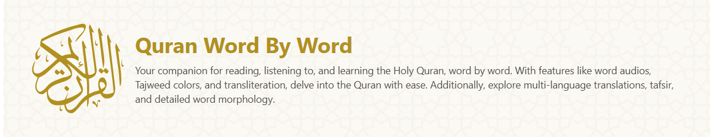

<br />
<div align="center">
  <a target="_blank" href="https://quranwbw.com"></a>
  <br />
</div>

## About

QuranWBW.com is your companion for reading, listening to, and learning the Holy Quran, word-by-word. With features like word audios, Tajweed colors, and transliteration, you can delve into the Quran with ease. Additionally, explore multi-language translations, tafsir, and detailed word morphology.

## Project Status

This is a passion project maintained in spare time. Development happens in bursts, and there may be periods of inactivity lasting weeks or months. Bug fixes and feature requests will be addressed as time permits. Your patience and understanding are appreciated.

## Community

Join the official QuranWBW Discord server to discuss the project, share feedback, report issues, suggest features, and connect with other users and contributors.

**[Join us on Discord](https://discord.gg/VSGJKsarxW)**.

## Stack & Architecture

QuranWBW’s frontend is built with [SvelteKit](https://svelte.dev/), delivering a fast, lightweight, and highly reactive user experience.

Unlike many Quran-related websites, QuranWBW does not rely on any real-time external APIs, by this we mean APIs hosted on a server that fetch custom data from a database on-demand.
Instead, we use pre-generated static JSON files containing all the required Quran data.
These files are generated locally, uploaded, and served via our private CDN at `static.quranwbw.com`.

This CDN is hosted on Cloudflare and is optimized for speed and reliability. It contains:

- Complete Quran data files (verses, translations, morphology, etc.)
- Crucial metadata and indexing information
- Mushaf fonts and supporting assets
- Translation files in multiple languages

Verse audio is sourced from [EveryAyah](https://www.everyayah.com/), while all word-by-word audio files are served from our CDN.

We use the following external services and resources to power QuranWBW:

- [Tafsir API by spa5k](https://github.com/spa5k/tafsir_api) – External open-source static API providing various tafsir texts.
- [Kalimat API](https://www.kalimat.dev/) – AI-powered semantic search via a real-time API.

## Our Data

QuranWBW uses its very own data to give you that awesome word-by-word experience. We're always working to make it even better and bigger!

If you're looking for Quranic data for your own projects, a great place to start is the [Quranic Universal Library (QUL)](https://qul.tarteel.ai/). It's a cool spot with lots of data!

But if QUL doesn't have what you need, or you're curious about our data, just get in touch. We'll do our best to help you out.

Our data is licensed separately from the code, and much of it belongs to third parties with their own terms. Please don't scrape, hotlink, or rehost anything from QuranWBW.com or `static.quranwbw.com`. See the [License](#license) section.

## Development & Deployment

If you'd like to contribute, you can run the project locally as outlined below. Running it locally is allowed only to prepare contributions to this repository.

```bash
# Clone the repository
git clone https://github.com/marwan/quranwbw.git

# Navigate into the project directory
cd quranwbw

# Install project dependencies
npm install

# Start the development server
npm run dev

# Create a production build
npm run build

# Preview the production build locally
npm run preview
```

The application will typically be accessible at `http://localhost:5173`.

#### Styling with Tailwind CSS

This project uses [Tailwind CSS](https://tailwindcss.com/) for styling. All styles are compiled automatically during development and production builds.

You can freely make changes, and Tailwind configuration files without manually rebuilding the CSS — the build system handles compilation, minification, and updates for you behind the scenes.

#### Deployment

QuranWBW.com is hosted on Cloudflare Pages and deployed by the maintainers only.
The code may not be deployed or hosted anywhere else. See the [License](#license) section.

## Contribution

QuranWBW welcomes focused contributions that improve the project. You can help by reporting bugs, suggesting small features, improving documentation, or spreading the word.

#### Guidelines

- Discuss significant changes via GitHub issues first
- Match existing design patterns and code style
- Keep PRs focused (one feature or fix per PR)
- Include screenshots for UI changes
- Test in both development and production builds

#### Expectations

- Review and understand any AI-generated code you submit
- Follow the existing structure and naming conventions
- Avoid large refactors or changes across many files
- Discuss new dependencies before adding them

We can't accept large unfocused PRs, unreviewed AI-generated code, or changes that deviate from the existing design language.

If you're unsure about anything, don't hesitate to open an issue, join our [Discord server](https://discord.gg/VSGJKsarxW), or [email us](mailto:quranwbw@gmail.com).

Your contributions, big or small, help make QuranWBW better for everyone.

## License

Copyright (c) Marwan Ansari and the QuranWBW team. **All rights reserved.**

The code is public so you can read it and contribute back, and for nothing else. You may fork or clone this repository, modify your copy, and run it locally only to make a contribution here. Beyond that, you may not copy, use, host, deploy, modify, or redistribute it, or build a clone of QuranWBW.com, in whole or in part.

The data on QuranWBW.com has **its own, separate licensing**. Our word-by-word data, word audio, and compiled datasets are proprietary. Third-party data (Quran text editions, translations, tafsir, recitations, morphology, fonts) belongs to its owners and is used under their terms. Scraping, hotlinking, or rehosting any of it is not allowed.

Read the full terms in [LICENSE](./LICENSE). For permission requests, [email us](mailto:quranwbw@gmail.com).
